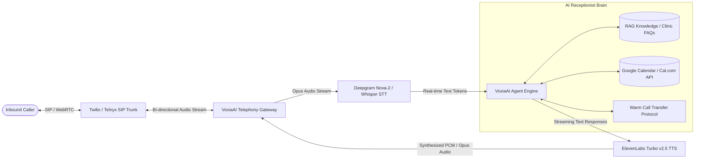

<div align="center">

# 🎙️ VoxiaAI

**Enterprise-Grade Autonomous AI Voice Receptionist Platform**

[](https://nextjs.org/)
[](https://react.dev/)
[](https://www.typescriptlang.org/)
[](https://tailwindcss.com/)
[](https://turbo.build/pack)
[](LICENSE)

<p align="center">
  <b>VoxiaAI</b> is a production-ready, full-stack voice orchestration platform designed to replace traditional phone trees with conversational AI receptionists. It autonomously answers inbound telephone calls, triages inquiries, checks real-time calendar availability, schedules appointments, and transfers emergency calls — operating 24/7 with human-level cadence and sub-350ms streaming voice latency.
</p>

[Key Features](#-key-features) • [Architecture](#-architecture--telephony-pipeline) • [Live Demos & UI](#-modules--ui-walkthrough) • [Tech Stack](#-technology-stack) • [Quickstart](#-getting-started) • [API & Telephony](#-telephony--integrations) • [Roadmap](#-roadmap)

</div>

---

## ⚡ Executive Overview

Modern clinics, legal practices, real estate firms, and service agencies lose up to 35% of potential clients to missed calls, long hold times, and rigid IVR menus. **VoxiaAI** solves front-desk bottlenecks through end-to-end voice automation:

- 🚀 **Sub-350ms Conversational Latency**: Near-zero pause audio streaming powered by ultra-fast acoustic synthesis.
- 🎯 **Domain-Specific Routines**: Battle-tested pre-configured behaviors for dental practices, medical triage, real estate showings, and dining reservations.
- 📅 **Dual-Engine Schedule Sync**: Autonomous calendar booking with real-time conflict avoidance across Google Calendar and Cal.com.
- 🎙️ **Studio-Grade Voices**: Integration with ElevenLabs (Rachel, Guy, Adam, Bella) and localized pronunciation in 10 languages.
- 💻 **Browser Audio Simulator**: Full Web Audio & Web Speech testing sandbox allowing staff to test AI responses in real-time before going live.

---

## 🏗 Architecture & Telephony Pipeline

VoxiaAI coordinates a low-latency, bi-directional audio pipeline connecting SIP telephony carriers to an intelligent LLM agent:



### The Conversational Turn Lifecycle:
1. **Inbound Signal**: SIP trunk signals caller ID and routes audio packets to the VoxiaAI session manager.
2. **Audio Ingestion & VAD**: WebRTC Voice Activity Detection (VAD) monitors speech boundaries with configurable interruption sensitivity.
3. **Contextual Evaluation**: The agent evaluates business hours, caller intent, insurance policies, and custom system instructions.
4. **Tool Execution**: When caller requests a time slot, the agent calls the calendar tool, confirms availability, and reserves the slot.
5. **Acoustic Playback**: Audio chunks stream back to the caller at 48kHz with natural human breathing and cadence.

---

## 🌟 Key Features

### 1. 🤖 AI Agent Configuration (`/dashboard/agent`)
- **Business Identity & Categorization**: Select from 9 tailored industry domains (Dental Clinic, Real Estate Agency, Healthcare, Legal Practice, Restaurant, Salon & Spa, Auto Services, Contractors, Custom).
- **Multi-Dialect Localization**: Native support for 10 primary languages including US/UK English, Spanish (LATAM & Castilian), French, German, Portuguese, Hindi, Italian, and Japanese.
- **Battle-Tested Prompt Routines**:
  - *Appointment Booking Routine*: Greets caller, checks return vs new patient status, offers 2–3 available slots, repeats summary for verification.
  - *Customer Support Routine*: Triage, account lookup, FAQ answers, de-escalation, and human supervisor routing.
  - *Real Estate Lead Qualifier*: Inquires on budget, target neighborhood, buyer/renter status, and books private agent showings.
  - *Restaurant Reservations*: Party size, seating time, dietary requirements, and valet parking directions.
  - *After-Hours Urgent Triage*: Assesses emergency severity, provides triage advice, and pages on-call staff via SMS.
- **Dynamic Variable Inserter**: Monospace prompt editor supporting token tags like `{business_name}`, `{office_hours}`, `{business_address}`, and `{primary_language}`.
- **Behavioral & Latency Tuning**: Sliders for interruption sensitivity, conversational tone (Warm, Polished, Direct), and latency targets (180ms vs 280ms vs Deep Reasoning).

### 2. 🎙️ Live Web Call Test Widget
- **Full In-Browser Testing Sandbox**: Click to dial your configured agent without burning telecom minutes.
- **Authentic Telephony Signaling**: Synthesizes realistic dual-tone multi-frequency ringback tones via the Web Audio API.
- **Dual Voice Input**: Talk directly into your microphone via browser Speech Recognition or type instant test queries.
- **Real-Time Visual Waveform**: Reactive multi-frequency animated audio visualizer syncing with agent and caller speech.
- **In-Call Telemetry**: Displays active duration, turn count, packet loss (0%), codec (Opus 48kHz), and latency metrics (~180ms).
- **Dockable & Floating**: Available both as a docked side rail in the configuration view and as a floating drawer on any page.

### 3. 📅 Appointments Management & Calendar (`/dashboard/appointments`)
- **Dual Presentation Modes**:
  - **List View Table**: Complete overview of Customer Name, Phone, Email, Service Requested, Booking Time, Status, and Provider.
  - **Monthly Calendar Grid**: Interactive calendar view with date jumping, day booking counters, and appointment detail drawers.
- **Live Status Workflows**: Color-coded badges for `Confirmed`, `Completed`, and `Cancelled`.
- **Quick Action Workflows**:
  - *Reschedule*: Fast modal to adjust visit date, time slot, and reason without leaving the table.
  - *Cancel*: 1-click cancellation with automated SMS follow-up triggers.
  - *Complete*: Mark patient visit concluded.
- **Top Stats Bar**: Live KPI meters displaying *Total Today*, *Upcoming This Week*, *Cancelled*, and *AI Autonomous Booking Rate (86%)*.
- **Manual Visit Booking Modal**: Comprehensive dialog to manually schedule phone or walk-in appointments.
- **1-Click CSV Export**: Instant spreadsheet download formatted for EHR/EMR and external CRM ingestion.

### 4. 📞 Inbound Call Logs & Transcripts (`/dashboard/calls`)
- **Detailed Telephony Feed**: Historical logs of every call received with caller telephone, timestamp, and duration.
- **Outcome Classification**: Categorizes calls as *Booked*, *Inquiry*, or *Missed*.
- **Slide-Over Transcript Drawer**: Read verbatim turn-by-turn conversations between callers and the AI receptionist.

---

## 🛠 Technology Stack

```
Frontend Architecture       Next.js 16.4 (App Router) + React 19.3
Language / Compiler         TypeScript 5.x + Strict Type Checking
Styling Framework           Tailwind CSS 4.0 + @tailwindcss/turbopack
Build Engine                Turbopack (Sub-second HMR & Fast Builds)
Iconography                 Lucide React
Audio & Speech APIs         Web Audio API + Web Speech API (Synthesis & Recognition)
Code Quality                ESLint 9 + react-hooks/purity rules
```

---

## 📂 Project Structure

```
VoxiaAI/
├── app/
│   ├── layout.tsx                     # Global HTML structure, Geist fonts & metadata
│   ├── page.tsx                       # Root landing route → redirects to /dashboard
│   ├── globals.css                    # Tailwind CSS 4 imports & dark theme variables
│   └── dashboard/
│       ├── layout.tsx                 # Dashboard master shell layout
│       ├── page.tsx                   # KPI metrics, call volume & upcoming bookings
│       ├── calls/
│       │   └── page.tsx               # Inbound call activity logs & transcript drawer
│       ├── appointments/
│       │   └── page.tsx               # Dual List/Calendar appointments management
│       ├── agent/
│       │   └── page.tsx               # AI Agent configuration & live web call test
│       ├── agent-setup/
│       │   └── page.tsx               # Legacy route redirect forwarder
│       ├── analytics/
│       │   └── page.tsx               # Financial ROI & telephony conversion stats
│       ├── phone-numbers/
│       │   └── page.tsx               # Inbound carrier number provisioning
│       └── settings/
│           └── page.tsx               # SIP credentials, API keys & webhooks
├── components/
│   └── dashboard/
│       ├── dashboard-shell.tsx        # Responsive layout container
│       ├── sidebar.tsx                # Main navigation bar with real-time status card
│       ├── header.tsx                 # Organization switcher & agent power toggle
│       ├── agent/                     # AI Agent configuration subsystem
│       │   ├── business-details-tab.tsx  # Business identity & category selector
│       │   ├── system-prompt-tab.tsx     # Custom prompt editor & pre-made routines
│       │   ├── voice-settings-tab.tsx    # ElevenLabs voice library & preview audio
│       │   ├── tools-tab.tsx             # Calendar tools, SMS & HIPAA compliance
│       │   ├── live-test-widget.tsx      # Web audio call simulator & waveform
│       │   ├── types.ts                  # Configuration TypeScript definitions
│       │   └── data.ts                   # Seed routines, voices & industry metadata
│       └── appointments/              # Appointments management subsystem
│           ├── appointments-table.tsx    # Searchable list view with quick actions
│           ├── calendar-view.tsx         # Monthly calendar grid with detail modal
│           ├── add-appointment-modal.tsx # Manual visit booking dialog
│           ├── reschedule-modal.tsx      # Quick date/time reschedule modal
│           ├── types.ts                  # Appointment data models
│           └── mock-data.ts              # Clinic services & schedule seed data
├── public/                            # Favicon, logos, and static assets
├── next.config.ts                     # Turbopack & Next.js compiler settings
├── tsconfig.json                      # Strict TypeScript compiler options
└── package.json                       # Dependencies & build scripts
```

---

## 🚀 Getting Started

### Prerequisites

- **Node.js**: `v18.17.0` or higher (Node 20+ recommended)
- **Package Manager**: `npm`, `pnpm`, or `yarn`

### Installation

```bash
# 1. Clone the repository
git clone https://github.com/abhishekgautam95/VoxiaAI.git
cd VoxiaAI

# 2. Install dependencies
npm install

# 3. Start local development server with Turbopack
npm run dev
```

The application will be accessible at [http://localhost:3000](http://localhost:3000).

### Available CLI Commands

```bash
npm run dev        # Launch Turbopack development server with instant HMR
npm run build      # Compile and generate production-optimized static build
npm run start      # Run production server on port 3000
npm run lint       # Execute strict ESLint 9 code quality analysis
```

---

## 🌐 Telephony & Integrations

### Environment Variables Template (`.env.local`)

```bash
# Telephony SIP Gateway
TWILIO_ACCOUNT_SID=ACXXXXXXXXXXXXXXXXXXXXXXXXXXXXXXXX
TWILIO_AUTH_TOKEN=your_auth_token_here
TWILIO_SIP_DOMAIN=voxia-trunk.sip.us1.twilio.com

# Voice Synthesis & Transcription
ELEVENLABS_API_KEY=xi_live_xxxxxxxxxxxxxxxxxxxxxxxx
DEEPGRAM_API_KEY=xxxxxxxxxxxxxxxxxxxxxxxxxxxxxxxx

# LLM Orchestrator
GEMINI_API_KEY=AIzaSyxxxxxxxxxxxxxxxxxxxxxxxxxxxx
OPENAI_API_KEY=sk-proj-xxxxxxxxxxxxxxxxxxxxxxxx

# Calendar Webhooks
CALCOM_API_KEY=cal_live_xxxxxxxxxxxxxxxxxxxx
GOOGLE_CALENDAR_CLIENT_ID=xxxxxxxx.apps.googleusercontent.com
GOOGLE_CALENDAR_CLIENT_SECRET=xxxxxxxxxxxxxxxxxxxxxxxx
```

---

## 🗺 Roadmap & Milestones

- [x] **Core Dashboard Infrastructure**: Responsive shell, sidebar, organization switcher, and metric cards.
- [x] **Call Activity Logs**: Inbound call logs with duration, status badges, and slide-over transcripts.
- [x] **AI Agent Configuration Engine**: Business details, routine templates, and ElevenLabs voice selector.
- [x] **In-Browser Web Call Test Simulator**: Ringback synthesizer, live speech recognition, and reactive waveform visualizer.
- [x] **Appointments Management**: Dual List and Calendar views, stats bar, CSV export, and manual booking dialog.
- [x] **Quick Action Workflows**: In-place rescheduling and cancellation dialogs.
- [ ] **Real-Time Telephony Gateway**: WebRTC/SIP bidirectional audio ingestion via Twilio/Telnyx.
- [ ] **Live Calendar OAuth Integration**: Bidirectional sync with Google Calendar, Outlook, and Cal.com.
- [ ] **Authentication & Multi-Tenant RBAC**: Clerk / Supabase Auth with granular team permissions.
- [ ] **Usage Metering & Stripe Invoicing**: Automated billing per telephony minute consumed.

---

## 🛡 Security & Compliance

- **HIPAA Data Handling Readiness**: Architecture supports PII/PHI redaction in call transcripts.
- **Audio Privacy**: Call recordings are encrypted at rest with TLS 1.3 in-transit encryption.
- **Configurable Guardrails**: Built-in escalation keywords guarantee automated handoff to live personnel for emergency situations.

---

## 📄 License

Distributed under the MIT License. See `LICENSE` for more information.

<div align="center">

**Built with pride by [Abhishek Gautam](https://github.com/abhishekgautam95)**  
*Empowering modern businesses with autonomous voice intelligence.*

</div>
